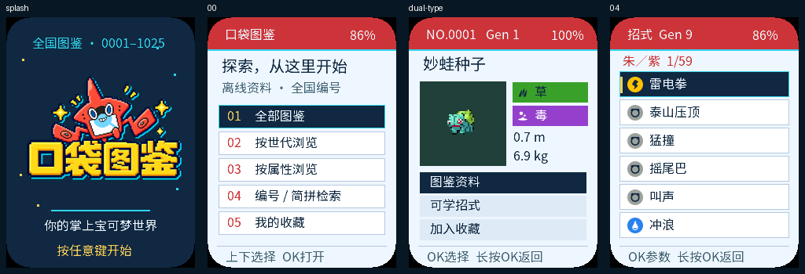

**简体中文** · [English](README.md)

# 口袋图鉴 · AI Passport

面向 ESP32-C3、8 MB Flash、无 PSRAM 的 AI Passport 开发板制作的离线中文图鉴。
通过三个实体按键浏览 1025 只宝可梦、阅读中文介绍、按编号或简拼检索、保存收藏，
并查看带游戏版本标注的可学招式。



本功能分支包含应用完整源码，复用 [FoloToy AI Passport](docs/README.zh_CN.md) BSP。
界面独立设计：洛托姆风格像素启动 Logo、红／青／深蓝配色，以及 18 种属性图标。
上图来自实际 LVGL 渲染，不是真机拍摄。

## 功能

- 全国编号 0001–1025，每只一个默认形态和一张静态像素图片。
- 中文名称与介绍、属性、首次登场世代、身高、体重和六项种族值。
- 按编号浏览、世代与属性组合筛选、编号或名称拼音首字母检索。
- 收藏及最近浏览记录断电保存。
- 可学招式名称、属性、威力、命中、基础 PP；每只采用一个游戏版本，独立标注招式世代与物种世代。
- 完全离线，无需叫声、Wi-Fi、账号或云服务。

招式数据优先使用 Gen 9《朱／紫》（733 只），其余采用 Gen 8（283 只）或
Gen 7（9 只），保留具体游戏标签，不混合版本。共 53,189 条去重关系、
1,832 个招式／版本参数组合。

## 操作

| 按键 | 行为 |
| --- | --- |
| 2.4 秒启动页内按任意键 | 跳过到首页，同一次按键不会误选菜单 |
| 上／下 | 选择或滚动；按住连续移动 |
| 短按 OK | 打开或确认 |
| 长按 OK | 返回 |
| 熄屏后的第一次按键 | 仅唤醒 |

输入 `25`、`0025` 或 `PKQ` 均可找到皮卡丘。检索使用中文名称简拼，非完整中文
输入法。从首页依次选择世代与属性可组合筛选；“全部图鉴”清除条件，检索与收藏
独立显示。在宝可梦详情页添加或取消收藏。空闲 30 秒调暗、90 秒熄灭背光，
不进入深度睡眠。

## 构建与刷写

准备 ESP-IDF 5.5.3，克隆本分支并激活环境后执行：

```sh
./tools/validate.sh
```

Windows 下先执行 `export.ps1`，准备 Git Bash 和本机 C 编译器，再执行
`bash tools/validate.sh`。仓库已包含生成的数据、字库和图标，正常构建无需图像生成工具。

验证后的合并文件为 `build/FoloToy-AI-Passport-full.bin`，刷写地址为 `0x0`。
匹配的 ELF／MAP 与分段文件归档到 `build/firmware/<合并固件SHA-256>/`。
合并写入可能重置 NVS 中的收藏；兼容的分段刷写可保留填充间隙。无需整片擦除。
应用保留原设备标识、Recovery 区域与上电按住 UP 五秒的引导入口。

## 验证与数据说明

构建与宿主机测试已通过：13 个 C 程序、111 个 Python 测试，两套字库各覆盖
2374 个字符，并完成 4000 次实际 LVGL 切页。已交付应用占 3 MiB 分区的 56.75%。
2026-10-04 用户确认已在设备上测试洛托姆 UI 修订；这是用户反馈的基本使用结果，
详细测量和逐项验收仍未取得证据。

确切固件／ELF 哈希、内存数据、来源、再生成方法与未验证项见[应用文档](docs/pokedex.zh_CN.md)。
四条中文说明的原游戏版本无法确定，页面明确标注；全部游戏资料尚未逐条对照原游戏校验。

宝可梦图片、名称和游戏文字保留各自权利，生成的同人 Logo 不是官方标志。
[资源目录](assets/README.zh_CN.md)保留第三方声明和来源记录。基础工程代码采用
[MIT 许可](LICENSE)，不代表第三方游戏素材被重新授权为 MIT。
